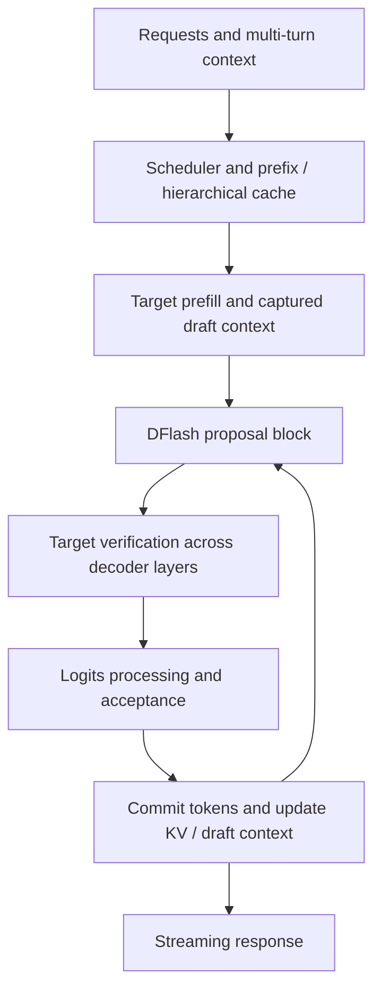

# Serving architecture review and optimization candidates

Reviewed 2026-10-24 against SGLang commit
`a55ab7d5ae1bba59ac351e55026fe7f7644ecc5f` and our three-patch experiment stack.

The first priority is to measure the expert path on the H200, then use full-node
traces to determine whether experts, attention, communication, or scheduling limit
serving. There are plausible savings in local routing and small-batch finalization,
but reducing their operation count does not establish a serving improvement.

## Evidence and limits

- The remote H200 is running the pinned challenge container with PyTorch
  `2.14.1+cu130`, CUDA runtime 13.0 and host driver 595.99.02.
- 280 GPU alignment contract checks and 256 GPU finalizer checks have passed.
- The full expert smoke test passed all five reference cases for stock and patch,
  with relative L2 errors approximately 0.54–0.56%, below the fixture's 1.5% bound.
  No-local routes also passed. Two-pair exploratory timings were 169.87 → 130.96 µs
  at 8 tokens and 202.46 → 200.86 µs at 32 tokens. These samples are insufficient
  for a performance conclusion; the repeated/profiled comparison is in progress.
  No full serving-score gain has been established.
- A subsequent 20-pair stock-vs-stack run passed correctness and found local,
  order-balanced speedups of 1.381x / 1.288x / 1.249x for 1 / 8 / 16 tokens.
  The respective exploratory 95% intervals were [1.359, 1.387], [1.240, 1.320],
  and [1.230, 1.271]. At 32 / 128 / 256 tokens the estimates were approximately
  1.008x / 1.006x / 1.006x, all inconclusive under the 2% screening margin.
  Independent-change measurements and reruns are still needed.
- The patched 128-token graph trace attributes about 452 µs per replay to the
  two Marlin GEMMs out of roughly 476 µs in the annotated replay span. This is
  diagnostic evidence that GEMMs dominate that case, not a clean timing result.
  It makes tile/padding policy a higher priority than another small finalizer edit.
- CPU tests cover control-flow safety, routing diagnostics, and measurement summaries.
  They do not establish GPU numerical correctness.
- The local harness uses synthetic official kernel inputs and excludes inter-GPU
  communication, attention, scheduling, checkpoint loading and pre-expert norm.
- Statements below about likely bottlenecks are hypotheses unless explicitly
  identified as source-code facts or measurements.

## What the serving benchmark rewards

The [rules](https://openkernelchallenge.dev/rules),
[serving description](https://openkernelchallenge.dev/#serving), and
[live configuration](https://openkernelchallenge.dev/api/v1/serving) are authoritative.
Our [configuration snapshot](../serving/benchmark-contract.json) is dated, not a
replacement for checking the live configuration before submission.

The workload contains hidden multi-turn agentic coding conversations at concurrency
1, 4, 16 and 32 on eight H200s. The score compares throughput per GPU at stock
interactivity and combines results across loads. We should retain the actual
throughput/interactivity curve rather than invent an exact local scoring formula.

Every request must return 220 tokens. Output agreement must be nearly as good as
stock-vs-stock agreement. A load whose TTFT exceeds twice stock cannot improve the
score. Prefill regressions therefore matter even when decode gets faster.

The launch uses TP8/EP8, Marlin NVFP4 experts, DFlash with eight draft tokens,
hierarchical caching, a 16,384-token prefill chunk, maximum context 131,072 and
maximum running requests 32. Verify block sizes of 8, 32, 128 and 256 are useful
diagnostics for the four loads; actual scheduling and graph padding can change the
executed shapes. Representative prefill tests are not the hidden serving dataset.

## End-to-end path



Inside a target decoder layer, attention projects Q/K/V/gate, performs QK norm,
RoPE where applicable, writes the FP8 KV cache, runs attention, normalizes/gates
the result and applies its output projection. A fused boundary combines the
attention branch with the FP32 residual stream and prepares the MoE input.

The MoE block projects into expert space and computes router scores on a side
stream. Routing selects eight of 256 experts. Under the challenge's EP8 layout,
each GPU holds 32 experts and forms a partial output. The expert path is:

```text
global IDs -> local IDs (-1 means another GPU) -> align/pad route slots
  -> NVFP4 gate/up GEMM -> BF16 SwiGLU -> NVFP4 down GEMM
  -> per-expert norm -> route-weighted sum
  -> cross-rank reduction -> unpool projection -> residual/norm boundary
```

The local kernel fixture uses hidden/intermediate width 4096. Expert weights remain
NVFP4; activations remain BF16 at stock boundaries; GEMMs request FP32 reduction.
The norm belongs to each expert output **before** summation. Moving it after
summation would change the model.

Relevant source anchors:

- [Decoder, attention, router and MoE orchestration](https://github.com/sgl-project/sglang/blob/a55ab7d5ae1bba59ac351e55026fe7f7644ecc5f/python/sglang/srt/models/muse_spark.py):
  `MuseSpark1xDecoderLayer.forward`, `MuseSpark1xAttention.gated_attention`,
  `MuseSpark1xMoE._forward_experts`, `_reduce_and_unpool`.
- [Marlin expert path](https://github.com/sgl-project/sglang/blob/a55ab7d5ae1bba59ac351e55026fe7f7644ecc5f/python/sglang/srt/layers/muse_spark_fp4_moe.py):
  `_marlin_expert_outputs`, `_forward_marlin`.
- [DFlash worker](https://github.com/sgl-project/sglang/blob/a55ab7d5ae1bba59ac351e55026fe7f7644ecc5f/python/sglang/srt/speculative/dflash_worker_v2.py):
  `forward_batch_generation`, `_accept_block`, `_greedy_sample_from_vocab_parallel_head`.
- [Attention backend](https://github.com/sgl-project/sglang/blob/a55ab7d5ae1bba59ac351e55026fe7f7644ecc5f/python/sglang/srt/layers/attention/flashattention_backend.py):
  graph metadata, FP8 cache handling, sliding-window and split-KV policy.

## Candidates, in investigation order

### First ablation outcome

The [independent-change matrix](../reports/2026-10-24-ablation.json) is complete.
Small-batch fusion alone produced paired estimates of 1.462x, 1.288x and 1.227x at
1, 8 and 16 tokens against the standalone baseline. This supports fusion as the
main low-token improvement. Local bucket reduction alone was slightly slower
(0.982x–0.999x), with no demonstrated gain. Omitting nonlocal blocks was inconclusive
under the 2% screening margin. Neither should be promoted merely because it does
less work. A second actual stock-vs-stack run reproduced the low-token improvement.

Routing diagnostics also exposed a concrete tile-policy mismatch: the 128/256-token
test batches averaged about 18.3% local routes, or 5.9/11.7 routes per local expert.
The stock heuristic sizes blocks from **all** eight routes per token divided by
the 32 local experts, selecting 48/64 rather than accounting for the global expert
population. The next experiment sweeps supported fixed tiles and a global-density
heuristic. It preserves routing and precision and uses only static shape/config
information. A smaller tile is a hypothesis, not yet a proven optimum.

| Candidate | Source evidence / hypothesis | Experiment and signals | Risk and validation |
|---|---|---|---|
| **1. Local expert bucket count** — implemented candidate | IDs are mapped to `[-1, 32)` but stock aligns with 256 expert buckets. Local counts reduce scratch and can select a different alignment dispatch. | Isolate patch 01; alignment kernel count/time, padding length, full expert latency across decode and prefill. | Changing dispatch can reorder equal-expert slots. Check all outputs, sentinel padding, irregular shapes and all-invalid batches. |
| **2. Small-batch fused finalize** — implemented candidate | Below 32 tokens, the helper uses multiple PyTorch operations instead of its existing fused Triton kernel. | Isolate patch 02 at 1, 8, 16, 31, 32 tokens; launches, occupancy, finalizer and total expert latency. | One CTA per token may underutilize the H200 at tiny batches. Reduction order differs; check reference error and ignored NaN slots. |
| **3. Omit nonlocal route blocks** — implemented candidate | Stock alignment retains `-1` routes, and Marlin scans expert block metadata. The masked finalizer does not need their outputs. | Isolate patch 03; routes per rank, aligned blocks, metadata scan cost, zero-local replay and prefill scaling. | Unwritten slots must never reach an unmasked consumer. Our dispatch enables this only with masked finalization. Verify fresh inputs and stale-buffer edge cases. |
| **4. Marlin tile/padding policy** | The block-M heuristic uses token count, top-k and local expert count rather than the actual local routing distribution. Skew can make this proxy inaccurate. | Sweep existing legal block sizes by shape/distribution; measure padding, per-GEMM latency and occupancy. Include hot-expert and nearby shapes. | Runtime GPU-to-host routing reads would add synchronization and violate graph capture. Use graph-safe policies and generalizable evidence; do not tune to seeds. |
| **5. Expert scratch/workspace reuse** | The serving method creates a workspace per invocation; the standalone kernel baseline reuses one. `cache13` already aliases gate/up and down storage. | Profile allocation/zeroing, eager prefill vs graph replay, peak memory and workspace launches. Test per-instance reusable buffers only if the cost is material. | Shared scratch can race across streams or graph executions, and Marlin locks must have correct initial state. Test graph lifetimes, overlapping work and shape changes. Avoid assuming graph allocation has eager cost. |
| **6. Prefill expert work organization** | Larger batches increase grouped GEMM work and routing padding. The kernel fixture is decode/verify-oriented, so it can miss prefill tradeoffs. | 753, 3012 and 16384 tokens plus nearby lengths; GEMM utilization, scratch bytes, routing skew, total expert latency. | A faster decode policy can slow TTFT. Retain shape-dependent dispatch only when it preserves model behavior and wins across representative shapes. |
| **7. Attention split-KV and metadata** | The backend has separate full/sliding-window metadata and split policies. Long-context full attention may dominate some turns. | Profile full and 2048-window layers across context lengths, graph buckets and verify lengths; KV bandwidth, metadata time, split/reduction overhead. | Attend to every required key; retain FP8 cache and allowed query precision. Check mixed lengths, page boundaries, and stale metadata. |
| **8. Router / pooler overlap** | Router work is already on a side stream, with a main-stream join; early input preparation is explicitly disabled for Marlin. | Timeline critical path, overlap percentage, router precision path, pooler and pre-norm duration. Only then investigate moving independent pre-norm work before the join. | Stream dependencies, tensor lifetimes and routing precision are sensitive. Preserve router semantics and compare expert choices; require graph and multi-rank tests. |
| **9. Collectives and unpool boundary** | Expert partial outputs are reduced before unpooling; there are conditional gather/fused-boundary paths. Some optimized branches are architecture-specific. | Eight-H200 traces: reduction/gather time, rank skew, overlap and selected paths on Hopper. | One H200 cannot validate collectives. Do not move reductions across nonlinear norms. Check rank-consistent dispatch, deadlocks and exact topology. |
| **10. DFlash graph coverage and vocabulary head** | There is an in-graph sampler path and an eager fallback; greedy acceptance is already fused. Reimplementing it may add complexity without benefit. | Graph-hit rate, bucket padding, draft forward/head time, acceptance histogram, target verify time, committed tokens per iteration. | Keep released drafter weights and prediction behavior. Any rounding change may alter acceptance and the serving curve; validate stock agreement. |
| **11. Scheduler and hierarchical cache** | Multi-turn traffic reuses context; the launch enables hierarchical caching and large prefill chunks. Queueing can dominate TTFT independently of kernels. | Full-node cache-hit/miss cases, queue delay, prefill/decode interference, transfer time, streaming latency and per-load curves. | Synthetic single-layer gains say nothing about scheduler behavior. Avoid trading all low-load interactivity for one throughput number. Preserve every request and token. |

## Existing optimizations not to duplicate blindly

The source already fuses QK norm/rope/cache writes where supported, attention norm
and gate, residual/norm boundaries, and greedy draft acceptance. Router projection
can use the supported BF16 hi/lo representation of FP32 weights. There are graph
and deferred-logits paths plus architecture-specific GEMM/gather implementations.
Inspect the path actually selected on H200 before proposing another fusion.

The presence of a Blackwell-specific implementation does not mean it is usable or
beneficial on Hopper. Likewise, a fast isolated kernel does not establish that the
same path is selected under the serving launch configuration.

## Measurement and diagnostic plan

Clean comparison and diagnostics have different purposes:

1. **Correctness first:** official FP32 reference, non-finite rejection, irregular
   shapes, skewed routes, no-local batches and captured replays with fresh inputs.
2. **Clean timings:** actual stock vs patched method; cold-cache graph replays,
   alternating AB/BA order, reusable preinitialized CUDA events and stored samples.
3. **Graph trace:** kernel launches and device timeline for the executed graphs.
4. **Eager stage trace:** diagnostic-only ranges for alignment, workspace,
   gate/up GEMM, SwiGLU, down GEMM and finalization, with Python stacks/shapes.
   Its measured durations must not be substituted for graph replay results.
5. **Context:** per-expert route histogram, local fraction, zero-local tokens,
   peak/allocated/reserved memory, source hashes, framework version and patch diff.
6. **Independent rerun:** repeat promising changes in a new process/session, vary
   seeds and nearby shapes, and investigate regressions before combining patches.
7. **Full serving:** stock-vs-stock variability, then stock-vs-patch on all four
   loads, including TTFT, interactivity, throughput, acceptance and output agreement.

The exploratory bootstrap intervals cover within-run sampling variation, not
thermal drift or generalization. A two-pair smoke test is only a functional check.
Our screening margin is local policy, not the competition's official confidence rule.

To decide what to optimize next, first estimate the component's fraction `f` of
the critical-path time. Even a component speedup `s` only gives an ideal total
speedup of `1 / (1 - f + f/s)`, before overlap and scheduling effects. Prefer a
measured large bottleneck over a visually complicated but insignificant function.

## Build and iteration costs

The pinned image is large and the first Marlin specialization compiles slowly.
`run_h200.sh` persists `/root/.cache` in `.gpu-cache` so subsequent containers can
reuse compiled kernels. Do not rebuild or change compiler flags during an A/B run.
Logs identify preparation/check/timing phases, and JSON checkpoints preserve
completed cases if profiling or a later shape fails.

Compile time is separate from latency but still matters to the judge's run limit
and to rental costs. First make a tiny run pass, then run the independent-change
matrix, then prefill regression checks. Do not start multiple timing jobs on the
same GPU; shared utilization would invalidate the comparison.

## Immediate next actions

1. Complete the current expert smoke test and fix any numerical/integration failure.
2. Run actual stock vs stack with clean timings and diagnostic traces.
3. Measure each of the three changes independently; keep only supported winners.
4. Use the traces to choose tile/padding, workspace, or prefill work next.
5. Treat communication, scheduler and full serving validation as eight-H200 work.

This review is a candidate map, not a performance claim or a substitute for the
official end-to-end benchmark.
