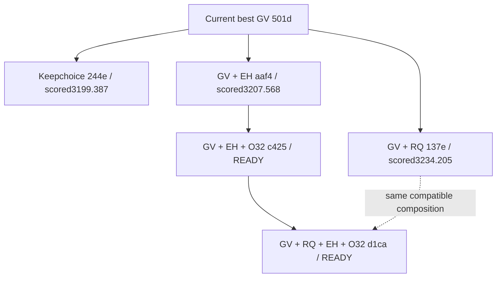

# Exact submission contents and queued stack

The three newer scored submissions were **parallel branches sharing current GV**, not a cumulative stack. All passed9/9; none beat GV's3157.038404us. Source presence below is distinct from actual per-shape selection and isolated benefit.

|Source / job|GV predxor|RQ predxor|Private EH|New O32 factor|Keepchoice policy|Official outcome / state|
|---|:---:|:---:|:---:|:---:|:---:|---|
|Current GV best `501d901db8ee` / `9916d34357b745cf`|yes|—|—|—|—|3157.038404us;9/9 **current best**|
|Keepchoice alternative `244e5b7d6bb8` / `c2b3b2f924e043a8`|yes|—|—|—|yes|3199.387492us;9/9; not best|
|GV + RQ predxor `137e0dbce0f0` / `22d677fa4501409f`|yes|yes|—|—|—|3234.204866us;9/9; not best|
|GV + private EH `aaf40d39d38a` / `ed28c762f3274df1`|yes|—|yes|—|—|3207.567539us;9/9; not best|
|GV + EH + O32 `c425148c9734` / `gv.privateeh.o32.fullpolicy.01`|yes|—|yes|yes|—|**READY queued; no score or win claim**|
|Complete compatible stack `d1ca973956a3` / `complete.gv.rq.eh.o32.fullpolicy.01`|yes|yes|yes|yes|—|**READY queued; no score or win claim**|

The queued complete source `d1ca973956a3a968796964679e8685741dba0d390e8f4c09f4b0794be108872b` includes all four compatible arithmetic/config changes. All six RQ/EH/O32 edit orders commute and invert; removingRQ recovers queuedc425 exactly. Keepchoice stays a separate alternative selector policy. Existing EH+O32 source/descriptor remains preserved.

Common PW45 ancestry already contains original RQ kernels, RTK, optionalEH and originalO32HALF52 contenders. The O32 column refers specifically to the new zero-minimum-gain comparison factor; it does not imply HALF52 was absent earlier. RQ-only scored3193.818257 is also preserved separately from the GV+RQ scored3234.204866 job.

Local EHfull30 points (+0.05417% paired/+0.22506%F1), O32-only mixed points (−0.01574%paired/+0.18669%F1), combined03mixed points, and every shape loss remain in linked reconciliation evidence. They are not added or converted into an official forecast. Source hashes, exact accepted receipts and raw completed results are in `analysis.json`. Complete-stack local control is currentGV; EH+O32 local control is measuredEH. Neither queued source has a scored claim.
